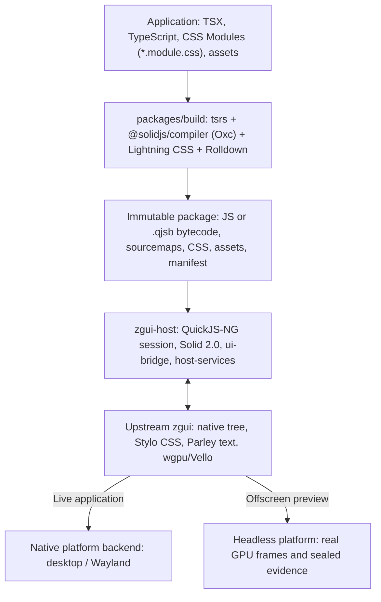

# zgui-js

**Native TSX applications powered by `zgui`, QuickJS-NG, and Solid 2.0.**

`zgui-js` is an experimental native UI host and SDK. Applications are written in TypeScript and TSX using Solid 2.0's reactive model through `@hewel/zgui`, compiled with `@solidjs/compiler` (Oxc), Lightning CSS Modules (`*.module.css`), and Rolldown into immutable SHA-256-sealed packages (optionally precompiled to QuickJS `.qjsb` bytecode), and executed inside an embedded QuickJS-NG runtime (`rquickjs`). A Rust host owns the native UI tree, Stylo styling, Taffy/Parley layout, GPU rendering, input dispatch, asynchronous host services, and application lifecycle.

**There is no WebView and no browser DOM.** Offscreen previews execute the same production application package, JavaScript session, UI bridge, and native renderer on a headless `wgpu` backend for deterministic screenshots, structural queries, and visual regression comparisons.

> **Independent project:** `zgui-js` builds on pinned revisions of [`zortax/zgui`](https://github.com/zortax/zgui) and is independently maintained; it is not an official `zgui` project or affiliated with its maintainers.

## How it works



Bun runs **only at build/CLI time**; application code executes on the Rust host's owner UI thread inside QuickJS-NG, driving native nodes across [`crates/ui-bridge`](crates/ui-bridge) rather than mutating a browser DOM. Platform and window-manager capabilities come from the pinned upstream `zgui` backend—`zgui-js` does not ship desktop environment adapters or compositor-specific daemons.

The host and SDK are structured around four core architectural boundaries (domain terms are defined in [`GLOSSARY.md`](GLOSSARY.md)):

1. **Zero-DOM Native UI & Lightning CSS Modules (`@hewel/zgui`)**
   A custom Solid 2.0 universal renderer drives native handles across `crates/ui-bridge`, paired with a themed component library (`@hewel/zgui/components`), selective headless primitives (`@hewel/zgui/primitives`), typed memory router (`@hewel/zgui/router`), vector icons (`@hewel/zgui/icons`), and Lightning CSS Modules (`lightningcss-v1`) validated against Stylo's native CSS subset.
2. **Immutable Packages & Fast Dev Loop (`packages/build`, `packages/cli`, `crates/zgui-host`)**
   Builds type-check with pinned `tsrs`, compile TSX via native `@solidjs/compiler` (zero Babel) and CSS Modules via Lightning CSS, and publish immutable SHA-256-verified packages (with optional code-splitting chunks, compute workers, and `--bytecode` `.qjsb` output). In `dev`, `tsrs` runs asynchronously without blocking rebuilds, CSS-only edits hot-swap Stylo stylesheets in place without restarting QuickJS, JS edits perform atomic staged reload with opt-in `createDevState` / router preservation, and failures surface in a non-blocking native dev error banner while keeping the last healthy frame alive.
3. **Shared Production Preview Pipeline & Self-Hosted Visual Inspector (`crates/zgui-host/src/preview`, `apps/devtools/inspector`)**
   Offscreen previews use the exact same package loader, QuickJS runtime, bridge, layout, and GPU renderer ([`driver.rs`](crates/zgui-host/src/preview/driver.rs), [`evidence.rs`](crates/zgui-host/src/preview/evidence.rs), [`output.rs`](crates/zgui-host/src/preview/output.rs)) rather than a mock DOM, emitting sealed `result.json` evidence, screenshots, and native tree snapshots. Live `--dev-inspect` sessions expose a read-only `0600` Unix socket, an in-window element picker (`Ctrl+Shift+I`), and a self-hosted Inspector window (`zgui-js inspect --ui`).
4. **Bounded Host Authority (`crates/js-runtime`, `crates/host-services`, `@hewel/zgui-services`)**
   JavaScript runs without `window`, `document`, `fetch`, `process`, or `setInterval`. Capability-gated host services (origin-allowlisted HTTP/SSE/WebSocket, SQLite/KV, local files & XDG portals, clipboard, Unix sockets, commands, control messages, and isolated background compute workers) retire cleanly with each session generation.

See [`llms.txt`](llms.txt) for a concise SDK/CLI map and [runtime ownership diagram](docs/development/tsx-native-ui.md#31-system-boundaries) / [preview execution diagram](docs/development/preview-mode.md#31-shared-production-path) for end-to-end architecture specs.

## Requirements

| Component        | Requirement                                                                                  |
| ---------------- | -------------------------------------------------------------------------------------------- |
| Rust             | `1.100.0`, pinned by [`rust-toolchain.toml`](rust-toolchain.toml) (only for building host)   |
| Bun              | `>=1.4.4` — runtime, package manager, and test runner (`bunfig.toml`, `bun.lock`)            |
| tsrs             | `7.1.0-beta.tsrs2`, installed locally via Bun (no global compiler required)                  |
| oxlint / oxfmt   | `1.94.0` / `0.79.0` (type-aware lint via `tsrs`, formatting via `oxfmt`)                     |
| Native toolchain | C/C++ compiler toolchain for `rquickjs` / native crates (when not using prebuilt host pkgs)  |
| Graphics         | Vulkan / GPU adapter and driver supported by the native `wgpu` renderer (or Mesa `llvmpipe`) |

- **Platform support:** Interactive examples and Wayland shells are verified on Linux with Wayland. Prebuilt host distribution follows npm `optionalDependencies` (`@hewel/zgui-host-linux-x64`, `@hewel/zgui-host-linux-arm64`), falling back automatically to Cargo inside a repo checkout.
- **Pinned dependencies:** Keep `Cargo.lock` and `bun.lock` when installing or building. See the [implementation baseline](docs/development/baseline.md) and [`vendor/README.md`](vendor/README.md) for audited pins and local native patches.

## Quick start

From the repository root:

```sh
bun install --frozen-lockfile
bun run dev --app counter
```

Useful CLI workflows via `@hewel/zgui-cli` (`zgui-js`):

```sh
bun run doctor                     # check Bun, zgui-host ABI, Wayland, Vulkan, XDG portal, tsrs, oxlint
bun run dev --app md-editor        # build & open Markdown Studio with async tsrs + CSS-only live reload
bun run build --app counter --bytecode
bun run package --app md-editor --bytecode --out target/md-editor-pkg
bun run inspect --ui --socket /tmp/app.inspect.sock
```

To scaffold a new standalone project:

```sh
bun create zgui-js my-app
# or: bun packages/cli/src/cli.ts init my-app --template desktop-app|wayland-shell
```

## Application model & SDK

- **Entry point:** `src/main.tsx` exports `hostApiVersion = 1` and `mount(root)`, returning the disposer from `renderApp(() => <App />, root)` (or `renderShell` for `--pure-shell` Wayland shells). See [`apps/examples/counter/src/main.tsx`](apps/examples/counter/src/main.tsx).
- **UI, Components & Primitives:** Import reactive primitives, `cx()`, and native elements from `@hewel/zgui`, themed components from `@hewel/zgui/components`, unstyled behavior primitives (Overlay/Presence/Roving/Menu) from `@hewel/zgui/primitives`, routing from `@hewel/zgui/router`, and vector icons from `@hewel/zgui/icons`. See [`llms.txt`](llms.txt), the [UI SDK guide](packages/ui/README.md), and the [component map](docs/development/component-map.md).
- **Styling & Assets:** Author global styles in `src/app.css` and scoped styles in `*.module.css` compiled by Lightning CSS (`lightningcss-v1`) with `--zui-*` tokens and `[data-*]` state selectors; compose classes with `cx(...)`. Package images, data files, and scoped fonts under `assets/` are declared in `package.json` (`zgui.*`) and SHA-256-verified at host load time.
- **Host Services:** `@hewel/zgui-services` provides capability-gated HTTP/SSE/WebSocket, SQLite/KV, local files/bookmarks, clipboard, Unix sockets, commands, control messages, image handles, and isolated compute workers. See the [host services guide](packages/services/README.md).
- **Execution Environment:** No `window`, `document`, `fetch`, `process`, or `setInterval`; supported styles are a strict native subset rather than full browser CSS.

## Examples

Run any example with `bun run dev --app <name>` or `bun run preview --app <name>`:

| Application   | Demonstrates                                                                                                     |
| ------------- | ---------------------------------------------------------------------------------------------------------------- |
| `counter`     | Signals, derived values, native buttons, and click events                                                        |
| `css-modules` | Scoped Lightning CSS Modules, flattened nesting, `--zui-*` theme switching, and `@layer zgui.components`         |
| `md-editor`   | Local-first Markdown Studio: `SplitPane`, `TreeView`, SQLite FTS5, local files/watcher, router, auxiliary window |
| `lists`       | Dynamic lists, `<VirtualList>`, and identity-based native node reuse                                             |
| `async`       | Timers, frame callbacks, promises, and asynchronous host services                                                |
| `editing`     | Native single-line and multiline editing, UTF-16 selection, IME composition, read-only, and disabled states      |
| `components`  | Styled primitives, layout tokens, themes, badges, and cards                                                      |
| `controls`    | Inputs, checkboxes, radios, switches, sliders, progress bars, and spinners                                       |
| `composition` | Accordions, collapsibles, and nested theme providers                                                             |
| `selection`   | Controlled and uncontrolled choice controls                                                                      |
| `tabs`        | Keyboard-navigable tabs and panels                                                                               |
| `gallery`     | Full interactive component showcase across themes, overlays, menus, and `CommandPalette`                         |

## Offscreen previews

Build and execute a deterministic offscreen scenario (initial frame capture, simulated pointer click, state assertion `Count: 1`, and updated capture):

```sh
bun run preview --app counter \
  --scenario preview/scenarios/counter-virtual.json \
  --out target/preview-counter-001
```

- Omit `--out` for a fresh directory under `target/`; omit `--scenario` for an initial-frame capture; `--profile` defaults to `preview/profiles/default.json` (use `preview/profiles/functional.json` for heavy debug-binary functional checks).
- Add `--watch` to supervise continuous scenario reruns on package changes.
- `preview compare` validates stored captures against reviewed baselines without opening a graphics device, rejecting environment or lockfile mismatches explicitly with mismatched field diagnostics (`E_BASELINE_INCOMPATIBLE`).

See [Preview implementation and verification](docs/development/preview-verification.md) for all commands, artifact contracts, and verification evidence.

## Checks and tests

```sh
bun run fmt:check     # oxfmt formatting check across the repository
bun run lint          # oxlint --deny-warnings + packages/ui/oxlint/plugin.mjs architectural gates
bun run typecheck     # all workspace packages, strict type fixtures, and apps via tsrs (--app <name> for one app)
bun run smoke         # build and verify the smoke package contract
bun run test:build    # Bun build, CLI, CSS Modules, primitives, llms.txt, and component-map tests
bun run test:rust     # workspace Rust tests + cargo clippy (-D warnings) offline
bun run test:vendor   # required offline test suites for patched vendor/ crates
bun run check         # fmt:check + lint + typecheck + test:build + test:rust + test:vendor
bun run test:preview  # build counter + zgui-host and run headless GPU preview suites
```

- `test:rust` and `test:vendor` allow 10 minutes per Cargo invocation by default, including build time. Override this with `ZGUI_CARGO_TIMEOUT_MS` (milliseconds). A timeout terminates the Cargo process group and fails the check.
- Install the tracked pre-commit hook (staged `oxfmt --check`, `lint`, `typecheck`) with `bun run hooks:install`.
- Real-desktop integration tests are marked `#[ignore]` and opt-in because they open live windows or interact with clipboard/IME state. Review the [native test notes](docs/development/baseline.md) before running them.

## Repository layout

| Path                                                 | Purpose                                                                                                            |
| ---------------------------------------------------- | ------------------------------------------------------------------------------------------------------------------ |
| [`crates/zgui-host`](crates/zgui-host)               | Package/bytecode loader, Wayland/desktop hosting, atomic & CSS-only reload, dev banner, visual inspector, preview  |
| [`crates/js-runtime`](crates/js-runtime)             | Embedded QuickJS-NG runtime, verified module/bytecode evaluation, turn guards, and rejection tracking              |
| [`crates/ui-bridge`](crates/ui-bridge)               | Native node handles, properties, event dispatch, geometry queries, canvas, and document selection                  |
| [`crates/host-services`](crates/host-services)       | Rust-backed async network, SQLite, files/bookmarks, clipboard, sockets, commands, and compute workers              |
| [`packages/ui`](packages/ui)                         | `@hewel/zgui` TSX SDK, renderer, router, primitives, components, icons, and `oxlint/plugin.mjs` preset             |
| [`packages/services`](packages/services)             | `@hewel/zgui-services` typed host-service client APIs                                                              |
| [`packages/build`](packages/build)                   | `@hewel/zgui-build` programmatic compiler (`@solidjs/compiler`, Lightning CSS, Rolldown), typecheck, packager      |
| [`packages/cli`](packages/cli)                       | `@hewel/zgui-cli` npm CLI (`zgui-js`: `init`, `dev`, `build`, `preview`, `package`, `doctor`, `inspect`, `smoke`)  |
| [`packages/create-zgui-js`](packages/create-zgui-js) | `create-zgui-js` project scaffolder (`bun create zgui-js`)                                                         |
| [`packages/host-linux-x64`](packages/host-linux-x64) | Prebuilt Linux x64 `zgui-host` npm `optionalDependencies` package                                                  |
| [`apps/devtools/inspector`](apps/devtools/inspector) | Self-hosted `zgui-js` visual Inspector window (`zgui-js inspect --ui`)                                             |
| [`apps/examples`](apps/examples)                     | Runnable example applications                                                                                      |
| [`preview`](preview)                                 | Preview profiles (`default.json`, `functional.json`), fixtures, scenarios, Noto fonts, comparison policies         |
| [`schemas/preview`](schemas/preview)                 | JSON Schemas for preview inputs and sealed output contracts                                                        |
| [`tests`](tests)                                     | Build, strict type, native-fixture, and GPU preview integration tests                                              |
| [`tools`](tools)                                     | Vendor test runner (`test-vendor.mjs`), memory profiler, host package staging, read-only `forge-status.ts`         |
| [`vendor`](vendor)                                   | Pinned upstream `zgui` crates with documented local patches ([`vendor/README.md`](vendor/README.md))               |
| [`docs/adr`](docs/adr)                               | Architecture Decision Records (`ADR-0001`–`ADR-0008`)                                                              |
| [`docs/development`](docs/development)               | Engineering specifications, crate/component maps, baseline contracts, and preview verification                     |
| [`docs/agents`](docs/agents)                         | GitHub issue/Project conventions ([`issue-tracker.md`](docs/agents/issue-tracker.md)), triage labels, domain rules |
| [`GLOSSARY.md`](GLOSSARY.md)                         | Canonical domain terminology shared across code and documentation                                                  |
| [`llms.txt`](llms.txt)                               | Machine-checked SDK & CLI reference for developers and coding agents                                               |

## Documentation

- [`llms.txt`](llms.txt) — concise SDK, primitives, services, and CLI reference.
- [`GLOSSARY.md`](GLOSSARY.md) — shared domain vocabulary.
- [`docs/adr/`](docs/adr) — architectural decisions (`ADR-0001` Solid 2.0 through `ADR-0008` Wave 3 DX & Primitives).
- [`docs/development/crate-map.md`](docs/development/crate-map.md) & [`docs/development/component-map.md`](docs/development/component-map.md) — package/crate layout and component parity map.
- [`packages/ui/README.md`](packages/ui/README.md), [`packages/services/README.md`](packages/services/README.md), & [`packages/build/README.md`](packages/build/README.md) — package contracts.
- [`docs/development/tsx-native-ui.md`](docs/development/tsx-native-ui.md) & [`docs/development/preview-mode.md`](docs/development/preview-mode.md) — core runtime and preview specifications.
- [`docs/development/baseline.md`](docs/development/baseline.md) & [`docs/development/preview-verification.md`](docs/development/preview-verification.md) — pinned baseline and recorded verification evidence.
- [`vendor/README.md`](vendor/README.md) — vendored upstream patches and crate-level regression gates.

## License

`zgui-js` is licensed under the **Apache License, Version 2.0** (see [`LICENSE`](LICENSE)).

Third-party and upstream attributions are collected in [`NOTICE`](NOTICE):

- Vendored native crates under `vendor/` and adapted UI resources under `packages/ui/src/components/generated/` originate from [`zortax/zgui`](https://github.com/zortax/zgui) (`Apache-2.0`, rev `ee29c7dc66206eb04ba7bcf514058a278c9070ba`; see [`vendor/README.md`](vendor/README.md) and [`packages/ui/upstream/ORIGIN`](packages/ui/upstream/ORIGIN)), including file-scoped `MPL-2.0` code in [`vendor/zgui-style/src/driver/recalc.rs`](vendor/zgui-style/src/driver/recalc.rs).
- Unmodified preview fixture fonts under `preview/fonts/` are redistributed under the **SIL Open Font License 1.1** (see [`preview/fonts/PROVENANCE.md`](preview/fonts/PROVENANCE.md)).
