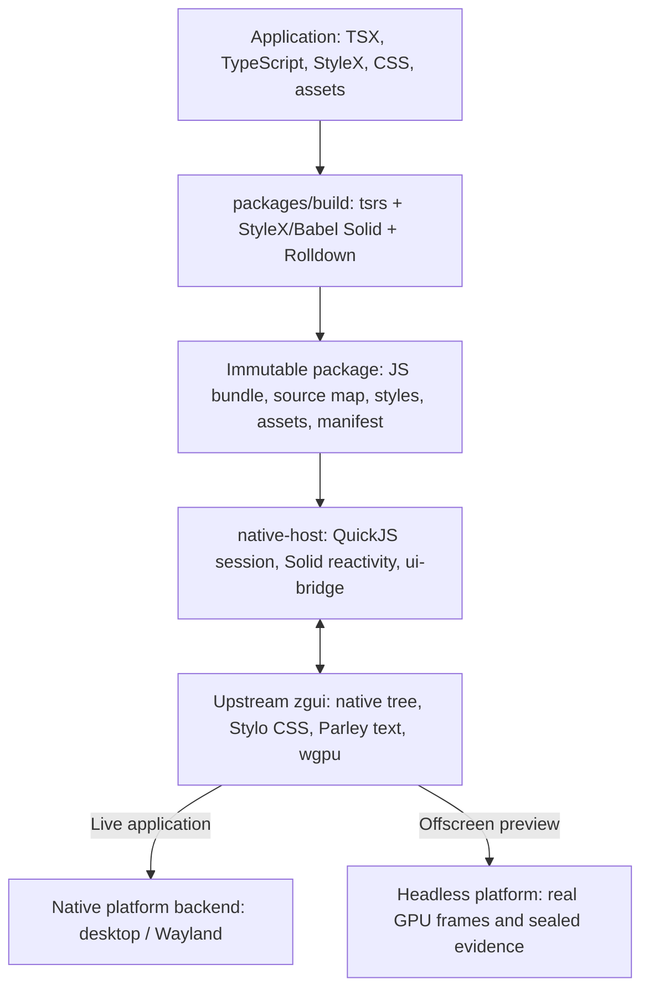

# zgui-js

**Native TSX applications powered by `zgui`, QuickJS, and Solid.**

`zgui-js` is an experimental native UI host and SDK. Applications are written in TypeScript and TSX using Solid's reactive model through `@hewel/zgui`, compiled with StyleX and Rolldown into immutable packages, and executed inside an embedded QuickJS runtime (`rquickjs`). A Rust host owns the native UI tree, styling, layout, GPU rendering, input dispatch, asynchronous host services, and application lifecycle.

**There is no WebView and no browser DOM.** Offscreen previews execute the same production application package, JavaScript session, UI bridge, and native renderer on a headless `wgpu` backend for deterministic screenshots, structural queries, and visual regression comparisons.

> **Independent project:** `zgui-js` builds on pinned revisions of [`zortax/zgui`](https://github.com/zortax/zgui) and is independently maintained; it is not an official `zgui` project or affiliated with its maintainers.

## How it works



Bun runs **only at build time**; application code executes on the Rust host's owner UI thread inside QuickJS, driving native nodes across [`crates/ui-bridge`](crates/ui-bridge) rather than mutating a browser DOM. Platform and window-manager capabilities come from the pinned upstream `zgui` backend—`zgui-js` does not ship desktop environment adapters or compositor-specific daemons.

The host and SDK are structured around four core architectural boundaries (domain terms are defined in [`GLOSSARY.md`](GLOSSARY.md)):

1. **Zero-DOM Native UI & StyleX (`@hewel/zgui`)**
   A custom Solid universal renderer drives native handles across `crates/ui-bridge`, paired with a themed component and overlay library (`@hewel/zgui/components`, `@hewel/zgui/icons`), owner-scoped geometry and animation queries, and `@stylexjs/babel-plugin` stylesheets validated against the `zgui-stylex-v1` native CSS profile.
2. **Immutable Packages & Atomic Session Reload (`packages/build`, `crates/native-host`)**
   Each build type-checks with the pinned `tsrs` compiler (`tsrs --noEmit`), compiles TSX/StyleX, and publishes an immutable, SHA-256-verified package publication. Source edits trigger **full-session reload** (not state-preserving HMR) via [`session_host.rs`](crates/native-host/src/session_host.rs) and [`session.rs`](crates/native-host/src/session.rs); if a later build or preflight check fails, the active generation stays running untouched.
3. **Shared Production Preview Pipeline (`crates/native-host/src/preview`)**
   Offscreen previews use the exact same package loader, QuickJS runtime, bridge, layout, and GPU renderer ([`driver.rs`](crates/native-host/src/preview/driver.rs), [`evidence.rs`](crates/native-host/src/preview/evidence.rs), [`output.rs`](crates/native-host/src/preview/output.rs)) rather than a mock DOM, emitting sealed `result.json` evidence, screenshots, and native tree snapshots.
4. **Bounded Host Authority (`crates/js-runtime`, `@hewel/zgui-services`)**
   JavaScript runs without `window`, `document`, `fetch`, `process`, or `setInterval`. Asset reads, timers, and frame callbacks pass through explicit host adapters ([`assets.rs`](crates/native-host/src/assets.rs), [`work.rs`](crates/native-host/src/work.rs)) and retire cleanly with each session generation.

See the [runtime ownership diagram](docs/development/tsx-native-ui.md#31-system-boundaries) and [preview execution diagram](docs/development/preview-mode.md#31-shared-production-path) for end-to-end diagrams.

## Requirements

| Component | Requirement |
| --- | --- |
| Rust | `1.100.0`, pinned by [`rust-toolchain.toml`](rust-toolchain.toml) |
| Bun | `>=1.4.4` — runtime, package manager, and test runner (`bunfig.toml`, `bun.lock`) |
| tsrs | `7.1.0-beta.tsrs2`, installed locally via Bun (no global compiler required) |
| oxlint / oxfmt | `1.94.0` / `0.79.0` (type-aware lint via `tsrs`) |
| Native toolchain | C/C++ compiler toolchain capable of building QuickJS (`rquickjs`) and native dependencies |
| Graphics | Vulkan / GPU adapter and driver supported by the native `wgpu` renderer |

- **Platform support:** Interactive examples have been verified on Linux with Wayland. Platform and window-manager support comes from upstream `zgui`.
- **Headless previews:** Offscreen previews do not open a desktop window, but still require a working `wgpu` graphics adapter—they render real GPU frames rather than software-only JS mocks.
- **Pinned dependencies:** Keep `Cargo.lock` and `bun.lock` when installing or building. See the [implementation baseline](docs/development/baseline.md) and [`vendor/README.md`](vendor/README.md) for audited pins and local native patches.

## Quick start

From the repository root:

```sh
bun install --frozen-lockfile
bun run dev --app counter
```

This single command compiles the native host with Cargo when stale, builds `apps/examples/counter`, opens a native window, and watches for changes. Ordinary TypeScript/TSX edits do not recompile Rust. Platform selection follows upstream `zgui` desktop detection; set `ZGUI_PLATFORM=wayland` to target Wayland explicitly.

Useful flags and lifecycle behavior:

- `bun run dev --app counter --exit-after-ms 5000` — run a bounded native launch for smoke checks.
- Closing the window stops the dev session; `Ctrl+C` stops the builder and its owned Cargo/native processes; a native crash exits rather than restarting silently.
- Native executable discovery respects Cargo's configured target directory.

### Per-example and external app workflows

Inside any example directory (or against any standalone app directory via `zgui-js dev /path/to/my-app`):

```sh
cd apps/examples/counter
bun run dev      # build, launch native window, watch and reload on changes
bun run build    # type-check and publish an immutable package (no window)
bun run preview  # build app + host and capture an offscreen GPU preview frame
```

- Standalone applications need `src/main.tsx`, `tsconfig.json`, SDK dependencies, and `@hewel/zgui-build` for the CLI (`zgui-js --help`). Root shortcuts default to `counter`; `bun run build --app counter --watch` exposes the builder-only mode for custom supervisors.
- Watching uses a persistent Rolldown watcher and per-compiler Babel/Solid transform cache. [Rolldown 1.3.2 still rescans the module graph](https://github.com/rolldown/rolldown/blob/v1.3.2/crates/rolldown_watcher/src/watch_task.rs#L122-L123); unchanged modules skip Babel transforms while `tsrs` still gates every publication.

## Application model & SDK

- **Entry point:** `src/main.tsx` exports `hostApiVersion = 1` and `mount(root)`, returning the disposer from `renderApp`. See [`apps/examples/counter/src/main.tsx`](apps/examples/counter/src/main.tsx).
- **UI & Components:** Import reactive primitives and native elements from `@hewel/zgui`, themed components and overlays from `@hewel/zgui/components`, and vector icons from `@hewel/zgui/icons`. See the [UI SDK guide](packages/ui/README.md) and [component map](docs/development/component-map.md).
- **Styling & Assets:** Optional `src/app.css` loads before compiled StyleX sheets, both validated by `zgui-stylex-v1` preflight. Package images, data files, and scoped fonts under `assets/` are declared in the manifest and verified at host load time. See [StyleX authoring and native packaging](docs/development/stylex.md).
- **Host Services:** `@hewel/zgui-services` provides `readTextAsset`, `HostRequest`, and `HostServiceError`. Start work from mount, lifecycle, or event callbacks, and cancel requests, timers, and frame callbacks on disposal. See the [host services guide](packages/services/README.md).
- **Execution Environment:** No `window`, `document`, `fetch`, `process`, or `setInterval`; supported styles are a strict native subset rather than full browser CSS.

## Examples

Run any example with `bun run dev --app <name>` or `bun run preview --app <name>`:

| Application | Demonstrates |
| --- | --- |
| `counter` | Signals, derived values, native buttons, and click events |
| `stylex` | Compiled StyleX styles, imported tokens/themes, dynamic values, keyframes, and package assets |
| `lists` | Dynamic lists and identity-based native node reuse |
| `async` | Timers, frame callbacks, promises, and asynchronous host services |
| `editing` | Native single-line and multiline editing, selection, IME composition, read-only, and disabled states |
| `components` | Styled primitives, layout tokens, themes, badges, and cards |
| `controls` | Inputs, checkboxes, radios, switches, sliders, progress bars, and spinners |
| `composition` | Accordions, collapsibles, and nested theme providers |
| `selection` | Controlled and uncontrolled choice controls |
| `tabs` | Keyboard-navigable tabs and panels |
| `gallery` | Full interactive component showcase across themes, overlays, and menus |

## Offscreen previews

Build and execute a deterministic offscreen scenario (initial frame capture, simulated pointer click, state assertion `Count: 1`, and updated capture):

```sh
bun run preview --app counter \
  --scenario preview/scenarios/counter-virtual.json \
  --out target/preview-counter-001
```

- Omit `--out` for a fresh directory under `target/`; omit `--scenario` for an initial-frame capture; `--profile` and `--fixture` default to `preview/profiles/default.json` and the empty fixture.
- Add `--watch` to supervise continuous scenario reruns on package changes (cancelling superseded runs and spawning fresh workers).
- The default profile renders an 800×600 logical surface at 1.75× scale (1400×1050 PNG), producing `result.json`, screenshots, native tree snapshots, frame evidence, an artifact manifest, and a bounded JSON summary on stdout. **Always use a fresh `--out` directory for each run**; historical screenshots never substitute for a current run.

Low-level host commands (once `native-host` is built):

```sh
target/debug/native-host preview doctor \
  --profile preview/profiles/default.json \
  --out target/preview-doctor-001

target/debug/native-host preview inspect \
  --run target/preview-counter-001 \
  --capture after-increment --test-id count-label \
  --fields text,state,boundsLogical --max-nodes 1

bun run preview:check --out target/preview-ci-001
```

`preview compare` validates stored captures against reviewed baselines without opening a graphics device, rejecting dimension or environment mismatches instead of rescaling. The checked-in visual baseline is tied to its recorded AMD/RADV/Mesa environment and is not expected to be portable across every GPU or driver; missing graphics adapters fail explicitly rather than skipping silently.

See [Preview implementation and verification](docs/development/preview-verification.md) for all commands, artifact contracts, and verification evidence.

## Checks and tests

```sh
bun run lint          # oxlint --deny-warnings + tools/oxlint-zgui-plugin.mjs architectural gates
bun run typecheck     # native packages, type fixtures, and examples via local tsrs 7.1.0-beta.tsrs2 CLI
bun run smoke         # build and verify the smoke package contract
bun run test:build    # Bun build, host-fixture, stylex, and component-map tests
bun run test:rust     # workspace Rust tests + cargo clippy (-D warnings) offline
bun run test:vendor   # required offline test suites for patched vendor/ crates
bun run check         # lint + typecheck + test:build + test:rust
bun run test:preview  # build counter + native-host and run headless GPU preview suites
```

- Type checking inside `bun run typecheck` and `bun run build` runs `tsrs --project … --noEmit` with pinned tsrs 7.1.0-beta.tsrs2 under ES2022-only consumer settings (no DOM or Node globals), without legacy compiler APIs or system `tsc` fallbacks.
- Real-desktop integration tests are marked `#[ignore]` and opt-in because they open live windows or interact with clipboard/IME state. Review the [native test notes](docs/development/baseline.md) before running them. Historical niri-specific notes in [P6 desktop verification](docs/development/preview-verification.md#p6--real-waylandniri-desktop-verification) are retained solely as archival evidence.

## Repository layout

| Path | Purpose |
| --- | --- |
| [`crates/native-host`](crates/native-host) | Package verification, native desktop/layer hosting, atomic reload, and preview CLI |
| [`crates/js-runtime`](crates/js-runtime) | Embedded QuickJS runtime, module evaluation, turn guards, and rejection tracking |
| [`crates/ui-bridge`](crates/ui-bridge) | Native node handles, properties, event dispatch, geometry queries, and structural ops |
| [`crates/host-services`](crates/host-services) | Rust-backed asynchronous host services |
| [`packages/ui`](packages/ui) | `@hewel/zgui` TSX SDK, universal renderer, themed components, icons, and native types |
| [`packages/services`](packages/services) | `@hewel/zgui-services` typed host-service client APIs |
| [`packages/build`](packages/build) | `@hewel/zgui-build` CLI (`zgui-js`), typecheck runner, StyleX/Babel/Solid compiler, watcher |
| [`apps/examples`](apps/examples) | Runnable example applications |
| [`preview`](preview) | Preview profiles, fixtures, scenarios, pinned Noto fonts, comparison policies, baselines |
| [`schemas/preview`](schemas/preview) | JSON Schemas for preview inputs and sealed output contracts |
| [`tests`](tests) | Build, type, native-fixture, and GPU preview integration tests |
| [`tools`](tools) | Custom `oxlint` architectural plugin ([`tools/oxlint-zgui-plugin.mjs`](tools/oxlint-zgui-plugin.mjs)) |
| [`vendor`](vendor) | Pinned upstream `zgui` crates with documented local patches ([`vendor/README.md`](vendor/README.md)) |
| [`docs/adr`](docs/adr) | Architecture Decision Records (Solid 2.0 posture, Wayland shell framework boundaries) |
| [`docs/development`](docs/development) | Engineering specifications, baseline contracts, StyleX docs, and preview verification |
| [`docs/agents`](docs/agents) | GitHub issue/Project conventions ([`issue-tracker.md`](docs/agents/issue-tracker.md)), triage labels, domain rules |
| [`GLOSSARY.md`](GLOSSARY.md) | Canonical domain terminology shared across code and documentation |

## Status, limitations, and roadmap

Development phases 0–8 and preview phases P0–P6 are complete, and active specifications and issues are tracked in **GitHub Project #1 (`zgui-js`)** ([project board](https://github.com/users/hewel/projects/1), [issues](https://github.com/hewel/zgui-js/issues)). Historical niri compositor integration and its panel example have been retired; earlier verification records remain strictly archival.

Current architectural boundaries and open workstreams:

- **Popup & desktop daemons:** Pinned upstream `zgui` does not support out-of-surface layer-parent `xdg-popup` windows. No compositor-specific WM, audio, MPRIS, or notification daemons are shipped inside the UI framework.
- **Solid 2.0 runtime ([`ADR-0001`](docs/adr/0001-solid-2-migration-posture.md)):** Upgraded to `solid-js@2.0.1` (`@solidjs/universal@2.0.1`, `@solidjs/babel-plugin@2.0.1`) with microtask-staged reactivity drained inside host checkpoints and a curated `@hewel/zgui` API surface.
- **Wayland shell capabilities ([`ADR-0002`](docs/adr/0002-wayland-shell-framework-boundaries.md)):** Planned generic framework additions—multi-output layer surfaces, live input regions, `ext-session-lock-v1`, spring physics, canvas/SVG documents, capability-gated dynamic images, sockets, subprocesses, and inbound control channels—are scoped so UI-independent system daemons stay outside `zgui-js`.
- **Verification scope:** Offscreen GPU previews do not replace real-desktop validation of compositor focus, IME, clipboard, or monitor hotplug; hardware timings remain environment-specific observations.

## Documentation

- [`GLOSSARY.md`](GLOSSARY.md) — shared domain vocabulary.
- [`docs/adr/0001-solid-2-migration-posture.md`](docs/adr/0001-solid-2-migration-posture.md) & [`docs/adr/0002-wayland-shell-framework-boundaries.md`](docs/adr/0002-wayland-shell-framework-boundaries.md) — architectural decisions.
- [`packages/ui/README.md`](packages/ui/README.md) & [`packages/services/README.md`](packages/services/README.md) — UI SDK and host-services contracts.
- [`docs/development/component-map.md`](docs/development/component-map.md) & [`docs/development/stylex.md`](docs/development/stylex.md) — component parity and StyleX native authoring.
- [`docs/development/tsx-native-ui.md`](docs/development/tsx-native-ui.md) & [`docs/development/preview-mode.md`](docs/development/preview-mode.md) — core runtime and preview specifications.
- [`docs/development/baseline.md`](docs/development/baseline.md) & [`docs/development/preview-verification.md`](docs/development/preview-verification.md) — pinned baseline and recorded verification evidence.
- [`vendor/README.md`](vendor/README.md) — vendored upstream patches and crate-level regression gates.

## License

`zgui-js` is licensed under the **Apache License, Version 2.0** (see [`LICENSE`](LICENSE)).

Third-party and upstream attributions are collected in [`NOTICE`](NOTICE):

- Vendored native crates under `vendor/` and adapted UI resources under `packages/ui/src/components/generated/` originate from [`zortax/zgui`](https://github.com/zortax/zgui) (`Apache-2.0`, rev `80baa3c7cb0fbbe1c058f10059e076e41c0a1b9a`; see [`vendor/README.md`](vendor/README.md) and [`packages/ui/upstream/ORIGIN`](packages/ui/upstream/ORIGIN)), including file-scoped `MPL-2.0` code in [`vendor/zgui-style/src/driver/recalc.rs`](vendor/zgui-style/src/driver/recalc.rs).
- Unmodified preview fixture fonts under `preview/fonts/` are redistributed under the **SIL Open Font License 1.1** (see [`preview/fonts/PROVENANCE.md`](preview/fonts/PROVENANCE.md)).
