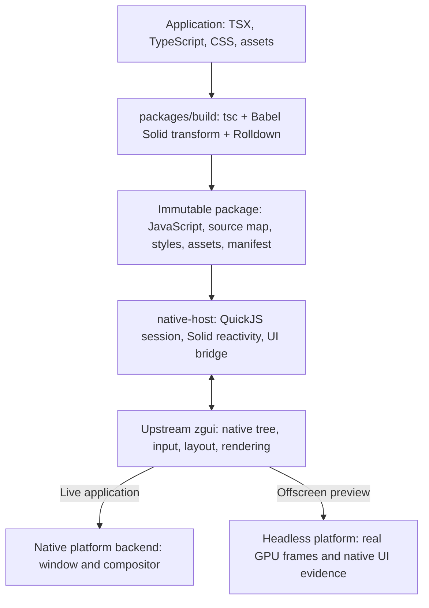

# zgui-js

**Native TSX applications powered by zgui, QuickJS, and Solid.**

zgui-js is an experimental native UI host. Applications are written in TypeScript and TSX, use Solid's reactive model through `@hewel/zgui`, and run in an embedded QuickJS runtime via rquickjs. A Rust host owns the native UI tree, styling, layout, rendering, input, asynchronous services, and application lifecycle.

zgui-js is independently maintained and is not an official zgui project or affiliated with its maintainers.

There is **no WebView and no browser DOM**. The repository also includes an offscreen preview system that uses the production application package, JavaScript runtime, UI bridge, and native renderer for scenario-based screenshots, assertions, and image comparisons.

## How it works



Node.js is used for build tooling, not application execution. The host validates the package and runs its JavaScript on the owner UI thread; Solid updates native nodes through the bridge rather than a browser DOM.

Platform and window-manager capabilities come from the pinned upstream zgui backend. zgui-js does not implement a WM adapter layer or compositor-specific services. Offscreen preview reuses the production session, bridge, and renderer; it is not a separate UI implementation.

See the [runtime ownership diagram](docs/development/tsx-native-ui.md#31-system-boundaries) and [preview execution diagram](docs/development/preview-mode.md#31-shared-production-path) for the detailed boundaries.

The Rust implementation concentrates lifecycle and evidence rules in shared modules; domain terms are defined in [GLOSSARY.md](GLOSSARY.md).

- [session_host.rs](crates/native-host/src/session_host.rs) owns generation allocation, replacement, retirement, and retry. Live and preview adapters use the same interface, with fallback or propagated failures selected explicitly.
- [session.rs](crates/native-host/src/session.rs) owns module evaluation and bounded work turns, returning typed diagnostics, contract failures, or host invariant errors. [integration.rs](crates/native-host/src/integration.rs) owns the baseline and exercise workflow.
- [assets.rs](crates/native-host/src/assets.rs) provides the seam for live and fixture asset adapters; scheduling and JavaScript promise roots remain in `work.rs`.
- [run/ledger.rs](crates/native-host/src/preview/run/ledger.rs) owns action progress and failure precedence. [evidence.rs](crates/native-host/src/preview/evidence.rs) owns capture identity, validation, paths, and historical publication.

These modules give callers leverage through shared behavior and maintainers locality for lifecycle, request, and publication tests. Tests cross the same interfaces used by the live host and preview.

## Requirements

| Component | Requirement |
| --- | --- |
| Rust | `1.100.0`, pinned by `rust-toolchain.toml` |
| Node.js | `>=26.13.0` |
| pnpm | `12.18.0` |
| TypeScript | `7.0.2`, installed locally by pnpm; no global compiler required |
| Native build tools | A C/C++ toolchain capable of building QuickJS and the native dependencies |
| Graphics | A graphics adapter and driver supported by the native wgpu renderer |

Interactive examples have been verified on Linux with Wayland. Platform and window-manager support is determined by upstream zgui; this library does not require a particular compositor or provide compositor-specific services.

Offscreen previews do not open a desktop window, but they still require a working graphics adapter. They are not software-only JavaScript screenshots.

Dependencies and upstream revisions are pinned. Keep `Cargo.lock` and `pnpm-lock.yaml` when installing or building. See the [implementation baseline](docs/development/baseline.md) for the audited dependency set and [vendor/README.md](vendor/README.md) for the local native patches.

## Quick start

From the repository root:

```sh
pnpm install --frozen-lockfile
pnpm dev --app counter
```

One command builds the native host with Cargo, builds the application, opens its
native window, and watches for changes. Cargo checks incremental freshness on
each launch; ordinary application edits do not rebuild Rust. Platform selection
uses upstream zgui's desktop detection; set `ZGUI_PLATFORM=wayland` to select
Wayland explicitly.

Click **Increment** to update the native **Count** and **Doubled** labels.
`pnpm dev --app counter --exit-after-ms 5000` requests a bounded native launch.
Closing the window ends the development session. Ctrl+C stops the builder and
its owned native/Cargo processes; a native failure exits rather than restarting
silently. Native executable discovery respects Cargo's configured target directory.

### Development and reload

The same commands work inside each example:

```sh
cd apps/examples/counter
pnpm dev
pnpm build
pnpm preview
```

`pnpm build` type-checks and publishes a package without opening a window.
`pnpm preview` builds the app and host, then captures an offscreen native frame;
it is not a browser preview server.

The `zgui-js` executable also accepts an application directory:
`zgui-js dev /path/to/my-app`. Applications need `src/main.tsx`, `tsconfig.json`,
their SDK dependencies, and `@hewel/zgui-build` for the CLI. No example-name allowlist
is required. `zgui-js --help` lists options; root commands default to `counter`.

Development uses a persistent Rolldown watcher and a per-compiler Babel/Solid
transform cache. [Rolldown 1.3.2 still rescans the module graph](https://github.com/rolldown/rolldown/blob/v1.3.2/crates/rolldown_watcher/src/watch_task.rs#L122-L123); unchanged source
avoids repeated Babel transformation, not all bundler work. Type checking still
gates publication. An initial build failure keeps the watcher alive and delays
host launch; a later failure leaves the active package unchanged. Correcting the
source publishes a new immutable generation and reloads the existing host.

This is **full-session reload, not state-preserving HMR**. JavaScript, CSS, and
assets publish atomically; rebuild rather than modifying an already published
generation. `pnpm build --app counter --watch` is the lower-level builder-only
entry for integrations that manage their own host. The former `ui:build` and
`ui:dev` script names have been replaced by `build` and `dev`.

## Examples

Use the same build and launch commands with another application name:

| Application | Demonstrates |
| --- | --- |
| `counter` | Signals, derived values, native buttons, and click events |
| `lists` | Dynamic lists and identity-based native node reuse |
| `async` | Timers, frame callbacks, promises, and asynchronous host services |
| `editing` | Native single-line and multiline editing, selection, IME, read-only, and disabled states |
| `components` | Styled primitives, layout tokens, themes, badges, and cards |
| `controls` | Inputs, checkboxes, radios, switches, sliders, progress, and spinners |
| `composition` | Accordions, collapsibles, and nested theme providers |
| `selection` | Controlled and uncontrolled choice controls |
| `tabs` | Keyboard-navigable tabs and panels |
| `gallery` | Full interactive component showcase across themes, overlays, and menus |

## Offscreen previews

One command prepares the application and native host and runs the counter
scenario. It captures the initial frame, performs a native pointer click, asserts
`Count: 1`, and captures the updated frame:

```sh
pnpm preview --app counter \
  --scenario preview/scenarios/counter-virtual.json \
  --out target/preview-counter-001
```

Omit `--out` for a fresh automatically named directory under `target/`.
Omit `--scenario` for the initial-frame capture. `--profile` and `--fixture`
default to the repository's default profile and empty fixture.

For continuous offscreen verification, use the same managed entry:

```sh
pnpm preview --app counter --watch \
  --scenario preview/scenarios/counter-virtual.json
```

This starts the builder and preview supervisor, not a desktop host. It owns and
cleans up the scenario workers; no second terminal is needed.

Low-level diagnostics remain available after preparing the host (the path below
assumes Cargo's default target directory):

```sh
target/debug/native-host preview doctor \
  --profile preview/profiles/default.json \
  --out target/preview-doctor-001
```

The default profile uses an 800×600 logical surface at 1.75× scale, producing 1400×1050 PNG images. Each run records a structured `result.json`, screenshots, native tree snapshots, frame evidence, and an artifact manifest. Stdout contains a bounded JSON summary.

Use a **new `--out` directory for every run**. Existing historical screenshots are not proof that a later run succeeded.

Inspect the native node associated with the final capture:

```sh
target/debug/native-host preview inspect \
  --run target/preview-counter-001 \
  --capture after-increment --test-id count-label \
  --fields text,state,boundsLogical --max-nodes 1
```

Additional workflows:

- `preview watch` follows atomic package publications, cancels superseded work, and reruns scenarios in fresh workers.
- `preview compare` compares stored captures against reviewed baselines without opening a graphics device. Incompatible dimensions or environments are rejected rather than silently rescaled or compared with relaxed thresholds.
- `pnpm preview:check --out target/preview-ci-001` runs the native scenario and compares it with the repository baseline. Build the counter and native host first.

The checked-in visual baseline is tied to its recorded AMD/RADV/Mesa environment and is not expected to be portable across every GPU and driver. A required graphics check fails when no adapter is available; it is not skipped and reported as successful.

See [Preview implementation and verification](docs/development/preview-verification.md) for all commands, failure categories, artifact contracts, and recorded evidence.

## Application model

- Import native components and reactive primitives from `@hewel/zgui`. Native nodes, events, and styles are not HTML or DOM APIs.
- The application entry point is `src/main.tsx`. It exports `hostApiVersion = 1` and `mount(root)`; `mount` returns the disposer supplied by `renderApp`. See the [counter source](apps/examples/counter/src/main.tsx).
- Optional `src/app.css` is packaged separately. Files under `assets/` are copied into the package and declared in its manifest; the host verifies and loads only declared resources.
- `@hewel/zgui-services` exposes `readTextAsset`, `HostRequest`, and `HostServiceError`. Start work from mount, lifecycle, or event callbacks, and cancel requests, timers, and frame callbacks during cleanup.
- The JavaScript environment does not provide `window`, `document`, `fetch`, `process`, or `setInterval`. Supported native styles are a deliberately bounded subset, not full browser CSS.

For API contracts, see the [UI SDK guide](packages/ui/README.md) and [host services guide](packages/services/README.md).

## Checks and tests

```sh
pnpm lint
pnpm typecheck
pnpm smoke
pnpm test:build
pnpm test:rust
pnpm check
pnpm test:preview
```

`pnpm lint` runs `oxlint --deny-warnings` (built-in rules plus `tools/oxlint-zgui-plugin.mjs` architectural gates). `pnpm check` runs lint, typechecking, build/property tests, and workspace Rust tests together.

`pnpm typecheck` checks the native SDK packages, consumer type fixtures, and examples with the pinned local TypeScript 7.0.2 CLI. Application builds use `tsc --project … --noEmit` before publication and preserve compiler diagnostics on failure. Development checks run in a cancellable child process. The build tooling does not use the legacy TypeScript compiler API or fall back to a system `tsc`. Native consumer configs remain ES2022-only, without DOM or Node globals.

`pnpm test:preview` builds the counter and native host before running the preview integration tests. Pixel-producing checks require a working graphics environment.

Real-desktop integration tests are separate opt-in, ignored tests. They may open windows, use the clipboard, or require coordinated keyboard/IME input. Read the [native test notes](docs/development/baseline.md) before enabling them; do not run every ignored test indiscriminately. The [P6 desktop verification record](docs/development/preview-verification.md#p6--real-waylandniri-desktop-verification) retains historical niri-specific evidence, whose compositor-specific gates and panel example are no longer shipped.

## Repository layout

| Path | Purpose |
| --- | --- |
| `crates/native-host` | Package loading, native hosting, session reload, upstream layer-shell configuration, and preview CLI |
| `crates/js-runtime` | Embedded JavaScript execution and runtime boundaries |
| `crates/ui-bridge` | Native node handles, properties, events, and structural operations |
| `crates/host-services` | Rust-backed resource services |
| `packages/ui` | Native TSX SDK, components, renderer adapter, and types |
| `packages/services` | Typed application-facing host services |
| `packages/build` | Type checking, TSX compilation, package publication, and build watching |
| `apps/examples` | Runnable example applications |
| `preview` | Profiles, fixtures, scenarios, pinned fonts, comparison policies, and visual baselines |
| `schemas/preview` | JSON Schemas for preview protocols |
| `tests` | Build, type, native-control, and preview tests |
| `vendor` | Required local patches at pinned upstream revisions |
| `docs/development` | Specifications, implementation baseline, and verification records |

## Status and limitations

Development phases 0–8 and preview phases P0–P6 have recorded completion evidence. These milestones do not imply complete browser or desktop feature parity. Historical niri integration, its panel example, and compositor-specific tests have since been removed; earlier verification records are retained as history, not current support claims.

Native UI, resource services, scheduling, previews, and the generic upstream layer-shell wrapper remain in scope. Runtime platform and compositor capabilities belong to upstream zgui.

Current limitations:

- The pinned upstream backend does not support layer-parent xdg-popups or native menus extending beyond layer-surface bounds.
- No window-manager, audio, or notification service backends are shipped.
- Offscreen scenarios do not replace real-desktop testing of focus, clipboard, IME, compositor behavior, or output lifecycle.
- Performance notes are scoped observations from specific environments, not general cross-hardware guarantees.

## Documentation

- [Development specification](docs/development/tsx-native-ui.md) — original native host and TSX requirements.
- [Preview specification](docs/development/preview-mode.md) — original preview-mode requirements.
- [Implementation baseline](docs/development/baseline.md) — pinned dependencies, runtime contracts, and native test guidance.
- [Preview verification](docs/development/preview-verification.md) — preview workflows and recorded acceptance evidence.
