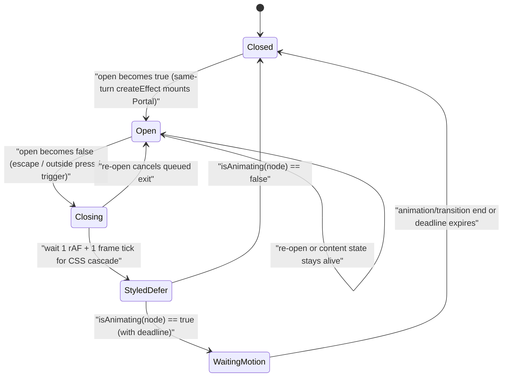
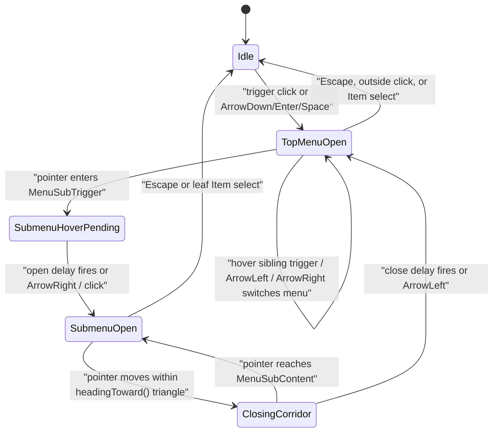

# Component Map & Feature Inventory

Machine-checked index of ported `@hewel/zgui/components` exports, Gallery interactive vocabulary (`testId`), unported upstream stylesheets, and key interactive statecharts. Verified against source by [`tests/build/component-map.test.mjs`](../../tests/build/component-map.test.mjs).

Root-forwarding components accept `class` and its StyleX alias `className`;
SDK structural classes remain privately owned, including through wrapped
components. Providers and multi-root composites have no implicit styling target.
`ThemeProvider` owns SDK tokens and applies the host's reduced-motion preference.
Props/ownership coverage: `tests/build/stylex-props.test.mjs` and native
`crates/ui-bridge/tests/properties.rs`.
All generated component sheets and theme presets are admitted by the strict native
parser in `crates/ui-bridge/tests/sdk_resources.rs`. Pinned native adaptations are
applied before generation and documented in `packages/ui/upstream/ORIGIN`.

## Exported Component & Helper Inventory

| Export                   | Source                                           | Gallery Section                    | Test Coverage                                 |
| ------------------------ | ------------------------------------------------ | ---------------------------------- | --------------------------------------------- |
| `ThemeProvider`          | `packages/ui/src/components/theme.ts`            | Shell                              | `tests/build/components.test.mjs`             |
| `useTheme`               | `packages/ui/src/components/theme.ts`            | Shell                              | `tests/build/components.test.mjs`             |
| `themeTokens`            | `packages/ui/src/components/generated/themes.ts` | Shell                              | `tests/build/components.test.mjs`             |
| `Icon`                   | `packages/ui/src/components/icons.ts`            | Atoms                              | `tests/build/components.test.mjs`             |
| `Button`                 | `packages/ui/src/components/button.ts`           | Atoms                              | `tests/build/components.test.mjs`             |
| `Badge`                  | `packages/ui/src/components/badge.ts`            | Atoms                              | `tests/build/components.test.mjs`             |
| `Card`                   | `packages/ui/src/components/card.ts`             | Composites                         | `tests/build/card-provider.test.mjs`          |
| `CardHeader`             | `packages/ui/src/components/card.ts`             | Composites                         | `tests/build/components.test.mjs`             |
| `CardTitle`              | `packages/ui/src/components/card.ts`             | Composites                         | `tests/build/components.test.mjs`             |
| `CardDescription`        | `packages/ui/src/components/card.ts`             | Composites                         | `tests/build/components.test.mjs`             |
| `CardAction`             | `packages/ui/src/components/card.ts`             | Composites                         | `tests/build/components.test.mjs`             |
| `CardContent`            | `packages/ui/src/components/card.ts`             | Composites                         | `tests/build/components.test.mjs`             |
| `CardFooter`             | `packages/ui/src/components/card.ts`             | Composites                         | `tests/build/components.test.mjs`             |
| `Separator`              | `packages/ui/src/components/separator.ts`        | Atoms                              | `tests/build/components.test.mjs`             |
| `Kbd`                    | `packages/ui/src/components/kbd.ts`              | Atoms                              | `tests/build/components.test.mjs`             |
| `KbdGroup`               | `packages/ui/src/components/kbd.ts`              | Atoms                              | `tests/build/components.test.mjs`             |
| `AspectRatio`            | `packages/ui/src/components/aspect-ratio.ts`     | Composites                         | `tests/build/components.test.mjs`             |
| `ButtonGroup`            | `packages/ui/src/components/button-group.ts`     | Atoms                              | `tests/build/components.test.mjs`             |
| `ButtonGroupText`        | `packages/ui/src/components/button-group.ts`     | Atoms                              | `tests/build/components.test.mjs`             |
| `ButtonGroupSeparator`   | `packages/ui/src/components/button-group.ts`     | Atoms                              | `tests/build/components.test.mjs`             |
| `Input`                  | `packages/ui/src/components/input.ts`            | Fields                             | `tests/preview/controls.test.mjs`             |
| `Textarea`               | `packages/ui/src/components/input.ts`            | Fields                             | `tests/preview/controls.test.mjs`             |
| `Label`                  | `packages/ui/src/components/label.ts`            | Fields                             | `tests/preview/controls.test.mjs`             |
| `Checkbox`               | `packages/ui/src/components/choices.ts`          | Choices                            | `tests/preview/selection.test.mjs`            |
| `Switch`                 | `packages/ui/src/components/choices.ts`          | Choices                            | `tests/preview/selection.test.mjs`            |
| `Toggle`                 | `packages/ui/src/components/choices.ts`          | Choices                            | `tests/preview/selection.test.mjs`            |
| `Skeleton`               | `packages/ui/src/components/skeleton.ts`         | Feedback                           | `tests/preview/controls.test.mjs`             |
| `Spinner`                | `packages/ui/src/components/spinner.ts`          | Feedback                           | `tests/preview/controls.test.mjs`             |
| `Progress`               | `packages/ui/src/components/progress.ts`         | Feedback                           | `tests/preview/controls.test.mjs`             |
| `Alert`                  | `packages/ui/src/components/alert.ts`            | Feedback                           | `tests/preview/controls.test.mjs`             |
| `AlertTitle`             | `packages/ui/src/components/alert.ts`            | Feedback                           | `tests/preview/controls.test.mjs`             |
| `AlertDescription`       | `packages/ui/src/components/alert.ts`            | Feedback                           | `tests/preview/controls.test.mjs`             |
| `Avatar`                 | `packages/ui/src/components/avatar.ts`           | Composites                         | `tests/preview/composition.test.mjs`          |
| `AvatarImage`            | `packages/ui/src/components/avatar.ts`           | Composites                         | `tests/preview/composition.test.mjs`          |
| `AvatarFallback`         | `packages/ui/src/components/avatar.ts`           | Composites                         | `tests/preview/composition.test.mjs`          |
| `AvatarBadge`            | `packages/ui/src/components/avatar.ts`           | Composites                         | `tests/preview/composition.test.mjs`          |
| `AvatarGroup`            | `packages/ui/src/components/avatar.ts`           | Composites                         | `tests/preview/composition.test.mjs`          |
| `AvatarGroupCount`       | `packages/ui/src/components/avatar.ts`           | Composites                         | `tests/preview/composition.test.mjs`          |
| `Empty`                  | `packages/ui/src/components/empty.ts`            | Composites                         | `tests/preview/composition.test.mjs`          |
| `EmptyHeader`            | `packages/ui/src/components/empty.ts`            | Composites                         | `tests/preview/composition.test.mjs`          |
| `EmptyMedia`             | `packages/ui/src/components/empty.ts`            | Composites                         | `tests/preview/composition.test.mjs`          |
| `EmptyTitle`             | `packages/ui/src/components/empty.ts`            | Composites                         | `tests/preview/composition.test.mjs`          |
| `EmptyDescription`       | `packages/ui/src/components/empty.ts`            | Composites                         | `tests/preview/composition.test.mjs`          |
| `EmptyContent`           | `packages/ui/src/components/empty.ts`            | Composites                         | `tests/preview/composition.test.mjs`          |
| `Item`                   | `packages/ui/src/components/item.ts`             | Composites                         | `tests/build/components.test.mjs`             |
| `ItemGroup`              | `packages/ui/src/components/item.ts`             | Composites                         | `tests/build/components.test.mjs`             |
| `ItemSeparator`          | `packages/ui/src/components/item.ts`             | Composites                         | `tests/build/components.test.mjs`             |
| `ItemMedia`              | `packages/ui/src/components/item.ts`             | Composites                         | `tests/build/components.test.mjs`             |
| `ItemContent`            | `packages/ui/src/components/item.ts`             | Composites                         | `tests/build/components.test.mjs`             |
| `ItemTitle`              | `packages/ui/src/components/item.ts`             | Composites                         | `tests/build/components.test.mjs`             |
| `ItemDescription`        | `packages/ui/src/components/item.ts`             | Composites                         | `tests/build/components.test.mjs`             |
| `ItemActions`            | `packages/ui/src/components/item.ts`             | Composites                         | `tests/build/components.test.mjs`             |
| `ItemHeader`             | `packages/ui/src/components/item.ts`             | Composites                         | `tests/build/components.test.mjs`             |
| `ItemFooter`             | `packages/ui/src/components/item.ts`             | Composites                         | `tests/build/components.test.mjs`             |
| `InputGroup`             | `packages/ui/src/components/input-group.ts`      | Fields                             | `tests/build/components.test.mjs`             |
| `InputGroupAddon`        | `packages/ui/src/components/input-group.ts`      | Fields                             | `tests/build/components.test.mjs`             |
| `InputGroupText`         | `packages/ui/src/components/input-group.ts`      | Fields                             | `tests/build/components.test.mjs`             |
| `InputGroupButton`       | `packages/ui/src/components/input-group.ts`      | Fields                             | `tests/build/components.test.mjs`             |
| `InputGroupInput`        | `packages/ui/src/components/input-group.ts`      | Fields                             | `tests/build/components.test.mjs`             |
| `InputGroupTextarea`     | `packages/ui/src/components/input-group.ts`      | Fields                             | `tests/build/components.test.mjs`             |
| `RadioGroup`             | `packages/ui/src/components/groups.ts`           | Choices                            | `tests/build/groups.test.mjs`                 |
| `RadioGroupItem`         | `packages/ui/src/components/groups.ts`           | Choices                            | `tests/build/groups.test.mjs`                 |
| `ToggleGroup`            | `packages/ui/src/components/groups.ts`           | Choices                            | `tests/build/groups.test.mjs`                 |
| `ToggleGroupItem`        | `packages/ui/src/components/groups.ts`           | Choices                            | `tests/build/groups.test.mjs`                 |
| `Slider`                 | `packages/ui/src/components/slider.ts`           | Choices                            | `tests/build/slider.test.mjs`                 |
| `Tabs`                   | `packages/ui/src/components/tabs.ts`             | Overlays & Gallery Shell           | `tests/preview/tabs.test.mjs`                 |
| `TabsContent`            | `packages/ui/src/components/tabs.ts`             | Overlays & Gallery Shell           | `tests/preview/tabs.test.mjs`                 |
| `TabsList`               | `packages/ui/src/components/tabs.ts`             | Overlays & Gallery Shell           | `tests/preview/tabs.test.mjs`                 |
| `TabsTrigger`            | `packages/ui/src/components/tabs.ts`             | Overlays & Gallery Shell           | `tests/preview/tabs.test.mjs`                 |
| `Collapsible`            | `packages/ui/src/components/collapsible.ts`      | Overlays                           | `tests/build/disclosure.test.mjs`             |
| `CollapsibleTrigger`     | `packages/ui/src/components/collapsible.ts`      | Overlays                           | `tests/build/disclosure.test.mjs`             |
| `CollapsibleContent`     | `packages/ui/src/components/collapsible.ts`      | Overlays                           | `tests/build/disclosure.test.mjs`             |
| `Accordion`              | `packages/ui/src/components/accordion.ts`        | Overlays                           | `tests/preview/disclosure.test.mjs`           |
| `AccordionItem`          | `packages/ui/src/components/accordion.ts`        | Overlays                           | `tests/preview/disclosure.test.mjs`           |
| `AccordionTrigger`       | `packages/ui/src/components/accordion.ts`        | Overlays                           | `tests/preview/disclosure.test.mjs`           |
| `AccordionContent`       | `packages/ui/src/components/accordion.ts`        | Overlays                           | `tests/preview/disclosure.test.mjs`           |
| `Dialog`                 | `packages/ui/src/components/dialog.ts`           | Overlays                           | `tests/preview/dialog.test.mjs`               |
| `DialogTrigger`          | `packages/ui/src/components/dialog.ts`           | Overlays                           | `tests/preview/dialog.test.mjs`               |
| `DialogContent`          | `packages/ui/src/components/dialog.ts`           | Overlays                           | `tests/preview/dialog.test.mjs`               |
| `DialogHeader`           | `packages/ui/src/components/dialog.ts`           | Overlays                           | `tests/preview/dialog.test.mjs`               |
| `DialogTitle`            | `packages/ui/src/components/dialog.ts`           | Overlays                           | `tests/preview/dialog.test.mjs`               |
| `DialogDescription`      | `packages/ui/src/components/dialog.ts`           | Overlays                           | `tests/preview/dialog.test.mjs`               |
| `DialogFooter`           | `packages/ui/src/components/dialog.ts`           | Overlays                           | `tests/preview/dialog.test.mjs`               |
| `DialogClose`            | `packages/ui/src/components/dialog.ts`           | Overlays                           | `tests/preview/dialog.test.mjs`               |
| `DialogDismiss`          | `packages/ui/src/components/dialog.ts`           | Overlays                           | `tests/build/dialog.test.mjs`                 |
| `Popover`                | `packages/ui/src/components/popover.ts`          | Overlays                           | `tests/preview/popover.test.mjs`              |
| `PopoverTrigger`         | `packages/ui/src/components/popover.ts`          | Overlays                           | `tests/preview/popover.test.mjs`              |
| `PopoverContent`         | `packages/ui/src/components/popover.ts`          | Overlays                           | `tests/preview/popover.test.mjs`              |
| `PopoverHeader`          | `packages/ui/src/components/popover.ts`          | Overlays                           | `tests/preview/popover.test.mjs`              |
| `PopoverTitle`           | `packages/ui/src/components/popover.ts`          | Overlays                           | `tests/preview/popover.test.mjs`              |
| `PopoverDescription`     | `packages/ui/src/components/popover.ts`          | Overlays                           | `tests/preview/popover.test.mjs`              |
| `PopoverClose`           | `packages/ui/src/components/popover.ts`          | Overlays                           | `tests/preview/popover.test.mjs`              |
| `Popper`                 | `packages/ui/src/components/popper.ts`           | Overlays & Menus (internal/direct) | `tests/build/popper.test.mjs`                 |
| `solvePopper`            | `packages/ui/src/components/popper.ts`           | Helper                             | `tests/build/property-invariants.test.mjs`    |
| `Tooltip`                | `packages/ui/src/components/tooltip.ts`          | Overlays                           | `tests/preview/hover.test.mjs`                |
| `TooltipProvider`        | `packages/ui/src/components/tooltip.ts`          | Overlays                           | `tests/preview/hover.test.mjs`                |
| `TooltipTrigger`         | `packages/ui/src/components/tooltip.ts`          | Overlays                           | `tests/preview/hover.test.mjs`                |
| `TooltipContent`         | `packages/ui/src/components/tooltip.ts`          | Overlays                           | `tests/preview/hover.test.mjs`                |
| `TooltipArrow`           | `packages/ui/src/components/tooltip.ts`          | Overlays                           | `tests/preview/hover.test.mjs`                |
| `HoverCard`              | `packages/ui/src/components/hover-card.ts`       | Overlays                           | `tests/preview/hover.test.mjs`                |
| `HoverCardTrigger`       | `packages/ui/src/components/hover-card.ts`       | Overlays                           | `tests/preview/hover.test.mjs`                |
| `HoverCardContent`       | `packages/ui/src/components/hover-card.ts`       | Overlays                           | `tests/preview/hover.test.mjs`                |
| `DropdownMenu`           | `packages/ui/src/components/dropdown-menu.ts`    | Menus & Shell                      | `tests/preview/menu.test.mjs`                 |
| `DropdownMenuTrigger`    | `packages/ui/src/components/dropdown-menu.ts`    | Menus & Shell                      | `tests/preview/menu.test.mjs`                 |
| `DropdownMenuContent`    | `packages/ui/src/components/dropdown-menu.ts`    | Menus & Shell                      | `tests/preview/menu.test.mjs`                 |
| `MenuContent`            | `packages/ui/src/components/menu.ts`             | Menus                              | `tests/preview/menu.test.mjs`                 |
| `MenuTypeahead`          | `packages/ui/src/components/menu.ts`             | Menus                              | `tests/preview/menu.test.mjs`                 |
| `MenuItem`               | `packages/ui/src/components/menu.ts`             | Menus & Overlays                   | `tests/preview/menu.test.mjs`                 |
| `MenuCheckboxItem`       | `packages/ui/src/components/menu.ts`             | Menus                              | `tests/preview/menu.test.mjs`                 |
| `MenuRadioGroup`         | `packages/ui/src/components/menu.ts`             | Menus                              | `tests/preview/menu.test.mjs`                 |
| `MenuRadioItem`          | `packages/ui/src/components/menu.ts`             | Menus                              | `tests/preview/menu.test.mjs`                 |
| `MenuLabel`              | `packages/ui/src/components/menu.ts`             | Menus                              | `tests/preview/menu.test.mjs`                 |
| `MenuGroup`              | `packages/ui/src/components/menu.ts`             | Menus                              | `tests/preview/menu.test.mjs`                 |
| `MenuSeparator`          | `packages/ui/src/components/menu.ts`             | Menus                              | `tests/preview/menu.test.mjs`                 |
| `MenuShortcut`           | `packages/ui/src/components/menu.ts`             | Menus                              | `tests/preview/menu.test.mjs`                 |
| `MenuSub`                | `packages/ui/src/components/menu-sub.ts`         | Menus                              | `tests/preview/submenu.test.mjs`              |
| `MenuSubTrigger`         | `packages/ui/src/components/menu-sub.ts`         | Menus                              | `tests/preview/submenu.test.mjs`              |
| `MenuSubContent`         | `packages/ui/src/components/menu-sub.ts`         | Menus                              | `tests/preview/submenu.test.mjs`              |
| `headingToward`          | `packages/ui/src/components/menu-sub.ts`         | Helper                             | `tests/build/submenu.test.mjs`                |
| `ContextMenu`            | `packages/ui/src/components/context-menu.ts`     | Menus                              | `tests/preview/context-menu.test.mjs`         |
| `ContextMenuTrigger`     | `packages/ui/src/components/context-menu.ts`     | Menus                              | `tests/preview/context-menu.test.mjs`         |
| `ContextMenuContent`     | `packages/ui/src/components/context-menu.ts`     | Menus                              | `tests/preview/context-menu.test.mjs`         |
| `useContextMenuPlace`    | `packages/ui/src/components/context-menu.ts`     | Menus                              | `tests/preview/context-menu.test.mjs`         |
| `Menubar`                | `packages/ui/src/components/menubar.ts`          | Menus                              | `tests/preview/menubar.test.mjs`              |
| `MenubarMenu`            | `packages/ui/src/components/menubar.ts`          | Menus                              | `tests/preview/menubar.test.mjs`              |
| `MenubarTrigger`         | `packages/ui/src/components/menubar.ts`          | Menus                              | `tests/preview/menubar.test.mjs`              |
| `MenubarContent`         | `packages/ui/src/components/menubar.ts`          | Menus                              | `tests/preview/menubar.test.mjs`              |
| `MenubarArrows`          | `packages/ui/src/components/menubar.ts`          | Menus                              | `tests/preview/menubar.test.mjs`              |
| `MenubarItem`            | `packages/ui/src/components/menubar.ts`          | Menus                              | `tests/preview/menubar.test.mjs`              |
| `MenubarCheckboxItem`    | `packages/ui/src/components/menubar.ts`          | Menus                              | `tests/preview/menubar.test.mjs`              |
| `MenubarRadioItem`       | `packages/ui/src/components/menubar.ts`          | Menus                              | `tests/preview/menubar.test.mjs`              |
| `MenubarLabel`           | `packages/ui/src/components/menubar.ts`          | Menus                              | `tests/preview/menubar.test.mjs`              |
| `MenubarSeparator`       | `packages/ui/src/components/menubar.ts`          | Menus                              | `tests/preview/menubar.test.mjs`              |
| `MenubarShortcut`        | `packages/ui/src/components/menubar.ts`          | Menus                              | `tests/preview/menubar.test.mjs`              |
| `MenubarGroup`           | `packages/ui/src/components/menubar.ts`          | Menus                              | `tests/preview/menubar.test.mjs`              |
| `MenubarRadioGroup`      | `packages/ui/src/components/menubar.ts`          | Menus                              | `tests/preview/menubar.test.mjs`              |
| `SplitPane`              | `packages/ui/src/components/split-pane.ts`       | Workbench                          | `tests/preview/workbench-components.test.mjs` |
| `SplitPanePanel`         | `packages/ui/src/components/split-pane.ts`       | Workbench                          | `tests/preview/workbench-components.test.mjs` |
| `SplitPaneHandle`        | `packages/ui/src/components/split-pane.ts`       | Workbench                          | `tests/preview/workbench-components.test.mjs` |
| `Select`                 | `packages/ui/src/components/select.ts`           | Workbench                          | `tests/preview/workbench-components.test.mjs` |
| `Combobox`               | `packages/ui/src/components/select.ts`           | Workbench                          | `tests/preview/workbench-components.test.mjs` |
| `ToastProvider`          | `packages/ui/src/components/toast.ts`            | Workbench & Shell                  | `tests/preview/workbench-components.test.mjs` |
| `useToast`               | `packages/ui/src/components/toast.ts`            | Workbench                          | `tests/preview/workbench-components.test.mjs` |
| `toast`                  | `packages/ui/src/components/toast.ts`            | Workbench                          | `tests/preview/workbench-components.test.mjs` |
| `TreeView`               | `packages/ui/src/components/tree-view.ts`        | Workbench                          | `tests/preview/workbench-components.test.mjs` |
| `TreeItem`               | `packages/ui/src/components/tree-view.ts`        | Workbench                          | `tests/preview/workbench-components.test.mjs` |
| `CommandPalette`         | `packages/ui/src/components/command-palette.ts`  | Workbench                          | `tests/preview/command-palette.test.mjs`      |
| `CommandPaletteProvider` | `packages/ui/src/components/command-palette.ts`  | Workbench                          | `tests/preview/command-palette.test.mjs`      |
| `useCommandPalette`      | `packages/ui/src/components/command-palette.ts`  | Workbench                          | `tests/preview/command-palette.test.mjs`      |
| `scoreCommandMatch`      | `packages/ui/src/components/command-palette.ts`  | Helper                             | `tests/preview/command-palette.test.mjs`      |

## Gallery `testId` Vocabulary

Dynamic preset items also expose `preset-${name}` (`preset-base`, `preset-ocean`, `preset-forest`, `preset-ember`) when `preset-trigger` opens `preset-menu`.

| Identifier                      | File                                                | Role                                    |
| ------------------------------- | --------------------------------------------------- | --------------------------------------- |
| `gallery-page`                  | `apps/examples/gallery/src/main.tsx`                | Root scrollable showcase page           |
| `gallery-tabs`                  | `apps/examples/gallery/src/main.tsx`                | Top-level section tabs root             |
| `tab-atoms`                     | `apps/examples/gallery/src/main.tsx`                | Atoms section tab trigger               |
| `tab-feedback`                  | `apps/examples/gallery/src/main.tsx`                | Feedback section tab trigger            |
| `tab-fields`                    | `apps/examples/gallery/src/main.tsx`                | Fields section tab trigger              |
| `tab-choices`                   | `apps/examples/gallery/src/main.tsx`                | Choices section tab trigger             |
| `tab-composites`                | `apps/examples/gallery/src/main.tsx`                | Composites section tab trigger          |
| `tab-overlays`                  | `apps/examples/gallery/src/main.tsx`                | Overlays section tab trigger            |
| `tab-menus`                     | `apps/examples/gallery/src/main.tsx`                | Menus section tab trigger               |
| `tab-workbench`                 | `apps/examples/gallery/src/main.tsx`                | Workbench section tab trigger           |
| `last-action`                   | `apps/examples/gallery/src/shell.tsx`               | Action log pill in masthead             |
| `preset-trigger`                | `apps/examples/gallery/src/shell.tsx`               | Theme preset dropdown trigger           |
| `preset-menu`                   | `apps/examples/gallery/src/shell.tsx`               | Theme preset dropdown content           |
| `scheme-switch`                 | `apps/examples/gallery/src/shell.tsx`               | Light/dark theme switch                 |
| `scheme-badge`                  | `apps/examples/gallery/src/shell.tsx`               | Active `<preset> / <scheme>` badge      |
| `section-atoms`                 | `apps/examples/gallery/src/sections/atoms.tsx`      | Atoms tab section grid                  |
| `btn-default`                   | `apps/examples/gallery/src/sections/atoms.tsx`      | Primary sample button                   |
| `section-feedback`              | `apps/examples/gallery/src/sections/feedback.tsx`   | Feedback tab section grid               |
| `atoms-progress`                | `apps/examples/gallery/src/sections/feedback.tsx`   | Controlled progress bar                 |
| `progress-minus`                | `apps/examples/gallery/src/sections/feedback.tsx`   | Decrement progress button               |
| `progress-plus`                 | `apps/examples/gallery/src/sections/feedback.tsx`   | Increment progress button               |
| `atoms-progress-text`           | `apps/examples/gallery/src/sections/feedback.tsx`   | Progress percentage label               |
| `section-fields`                | `apps/examples/gallery/src/sections/fields.tsx`     | Fields tab section grid                 |
| `inputs-name`                   | `apps/examples/gallery/src/sections/fields.tsx`     | Controlled project name input           |
| `inputs-notes`                  | `apps/examples/gallery/src/sections/fields.tsx`     | Multiline release notes textarea        |
| `section-choices`               | `apps/examples/gallery/src/sections/choices.tsx`    | Choices tab section grid                |
| `inputs-terms`                  | `apps/examples/gallery/src/sections/choices.tsx`    | Terms checkbox                          |
| `inputs-slider`                 | `apps/examples/gallery/src/sections/choices.tsx`    | Interactive range slider                |
| `inputs-slider-text`            | `apps/examples/gallery/src/sections/choices.tsx`    | Slider numeric value readout            |
| `section-composites`            | `apps/examples/gallery/src/sections/composites.tsx` | Composites tab section grid             |
| `composites-card`               | `apps/examples/gallery/src/sections/composites.tsx` | Sample card with action slot            |
| `composites-avatar`             | `apps/examples/gallery/src/sections/composites.tsx` | Avatar with fallback + badge            |
| `avatar-toggle-src`             | `apps/examples/gallery/src/sections/composites.tsx` | Toggle broken/valid avatar source       |
| `section-overlays`              | `apps/examples/gallery/src/sections/overlays.tsx`   | Overlays tab section grid               |
| `overlay-dialog-trigger`        | `apps/examples/gallery/src/sections/overlays.tsx`   | Modal dialog trigger                    |
| `overlay-dialog-content`        | `apps/examples/gallery/src/sections/overlays.tsx`   | Modal dialog surface                    |
| `overlay-dialog-input`          | `apps/examples/gallery/src/sections/overlays.tsx`   | Autofocused input inside dialog         |
| `overlay-custom-dialog-trigger` | `apps/examples/gallery/src/sections/overlays.tsx`   | Custom DialogDismiss dialog trigger     |
| `overlay-custom-dismiss`        | `apps/examples/gallery/src/sections/overlays.tsx`   | Custom close action via DialogDismiss   |
| `overlay-popover-trigger`       | `apps/examples/gallery/src/sections/overlays.tsx`   | Anchored popover trigger                |
| `overlay-popover-content`       | `apps/examples/gallery/src/sections/overlays.tsx`   | Anchored popover surface                |
| `section-menus`                 | `apps/examples/gallery/src/sections/menus.tsx`      | Menus tab section grid                  |
| `menus-dropdown-trigger`        | `apps/examples/gallery/src/sections/menus.tsx`      | Action dropdown trigger                 |
| `menus-dropdown-content`        | `apps/examples/gallery/src/sections/menus.tsx`      | Action dropdown surface                 |
| `menus-context-trigger`         | `apps/examples/gallery/src/sections/menus.tsx`      | Context menu target area                |
| `menus-context-content`         | `apps/examples/gallery/src/sections/menus.tsx`      | Context menu popup surface              |
| `menus-context-open-at`         | `apps/examples/gallery/src/sections/menus.tsx`      | Programmatic openAt trigger             |
| `menus-editor-bar`              | `apps/examples/gallery/src/sections/menus.tsx`      | Horizontal menubar root                 |
| `menus-editor-view`             | `apps/examples/gallery/src/sections/menus.tsx`      | View menubar trigger                    |
| `menus-editor-view-content`     | `apps/examples/gallery/src/sections/menus.tsx`      | View menubar popup                      |
| `menus-editor-spacious`         | `apps/examples/gallery/src/sections/menus.tsx`      | Spacious density radio item             |
| `section-workbench`             | `apps/examples/gallery/src/sections/workbench.tsx`  | Workbench tab section grid              |
| `workbench-split-pane`          | `apps/examples/gallery/src/sections/workbench.tsx`  | Draggable horizontal split pane         |
| `workbench-split-left`          | `apps/examples/gallery/src/sections/workbench.tsx`  | Left split pane width readout badge     |
| `workbench-split-handle`        | `apps/examples/gallery/src/sections/workbench.tsx`  | Split pane resize handle                |
| `workbench-split-right`         | `apps/examples/gallery/src/sections/workbench.tsx`  | Right split pane width readout badge    |
| `workbench-select`              | `apps/examples/gallery/src/sections/workbench.tsx`  | Engine Select dropdown trigger          |
| `workbench-select-value`        | `apps/examples/gallery/src/sections/workbench.tsx`  | Selected engine readout badge           |
| `workbench-combobox`            | `apps/examples/gallery/src/sections/workbench.tsx`  | Searchable engine Combobox root         |
| `workbench-combobox-value`      | `apps/examples/gallery/src/sections/workbench.tsx`  | Combobox selected value readout badge   |
| `workbench-toast-success`       | `apps/examples/gallery/src/sections/workbench.tsx`  | Trigger success toast with Undo action  |
| `workbench-toast-error`         | `apps/examples/gallery/src/sections/workbench.tsx`  | Trigger error alert toast               |
| `workbench-toast-dismiss`       | `apps/examples/gallery/src/sections/workbench.tsx`  | Dismiss all active toasts               |
| `workbench-tree-selected`       | `apps/examples/gallery/src/sections/workbench.tsx`  | Active TreeView selection badge         |
| `workbench-tree`                | `apps/examples/gallery/src/sections/workbench.tsx`  | Data-driven workspace TreeView          |
| `workbench-tree-declarative`    | `apps/examples/gallery/src/sections/workbench.tsx`  | Declarative TreeItem outline TreeView   |
| `workbench-command-trigger`     | `apps/examples/gallery/src/sections/workbench.tsx`  | CommandPalette modal trigger button     |
| `workbench-command-last`        | `apps/examples/gallery/src/sections/workbench.tsx`  | Last executed command readout badge     |
| `workbench-command-palette`     | `apps/examples/gallery/src/sections/workbench.tsx`  | Workbench CommandPalette dialog surface |

## Unported Upstream Stylesheets

Upstream stylesheets synced into `packages/ui/src/components/generated/` that are not yet wrapped by components:

- `AlertDialogStyle`
- `BreadcrumbStyle`
- `CalendarStyle`
- `CarouselStyle`
- `ChartStyle`
- `DataTableStyle`
- `DatePickerStyle`
- `FieldGroupStyle`
- `FieldStyle`
- `FieldTextStyle`
- `FormStyle`
- `InputOtpStyle`
- `NativeSelectStyle`
- `NavigationMenuStyle`
- `PaginationStyle`
- `ScrollAreaStyle`
- `SheetStyle`
- `SidebarBandStyle`
- `SidebarMenuStyle`
- `SidebarStyle`
- `TableStyle`
- `VirtualListStyle`

## Interactive Statecharts

### Overlay & Presence Lifecycle

### Menubar & Submenu Corridor Handoff

## Headless Primitives (`@hewel/zgui/primitives`)

Zero-style behavioral primitives extracted from `@hewel/zgui/components` without `Portal`, `Popper`, or built-in stylesheet coupling (usable identically inside `WindowSurface`, `LayerSurface`, and `PopupSurface`):

| Export                      | Source Module                           | Role                                                                         |
| --------------------------- | --------------------------------------- | ---------------------------------------------------------------------------- |
| `createPresence`            | `packages/ui/src/primitives/overlay.ts` | Animation-aware mount/unmount presence controller                            |
| `createOverlayState`        | `packages/ui/src/primitives/overlay.ts` | Controlled/uncontrolled open state and anchor/content/label node refs        |
| `createDismissLayer`        | `packages/ui/src/primitives/overlay.ts` | Owner-scoped reactive dismiss layer wrapper                                  |
| `createRovingFocus`         | `packages/ui/src/primitives/roving.ts`  | Tree-ordered keyboard roving focus controller                                |
| `groupOrientation`          | `packages/ui/src/primitives/roving.ts`  | Orientation validator (`horizontal` / `vertical` / `both`)                   |
| `createDelayed`             | `packages/ui/src/primitives/delay.ts`   | Cancellable hover/typeahead delay scheduler                                  |
| `MenuRootPrimitive`         | `packages/ui/src/primitives/menu.ts`    | Headless menu hierarchy root (no Portal/Popper/CSS)                          |
| `MenuListPrimitive`         | `packages/ui/src/primitives/menu.ts`    | Headless `role="menu"` list with roving focus, typeahead, and Escape dismiss |
| `MenuItemPrimitive`         | `packages/ui/src/primitives/menu.ts`    | Headless `role="menuItem"` with `data-highlighted` / `data-disabled` hooks   |
| `MenuCheckboxItemPrimitive` | `packages/ui/src/primitives/menu.ts`    | Headless `role="menuItemCheckBox"` with `data-state="checked"\|"unchecked"`  |
| `MenuRadioGroupPrimitive`   | `packages/ui/src/primitives/menu.ts`    | Headless `role="group"` radio provider                                       |
| `MenuRadioItemPrimitive`    | `packages/ui/src/primitives/menu.ts`    | Headless `role="menuItemRadio"` with `data-state` / `data-value`             |
| `MenuSubPrimitive`          | `packages/ui/src/primitives/menu.ts`    | Headless nested submenu context with cascading dismiss                       |
